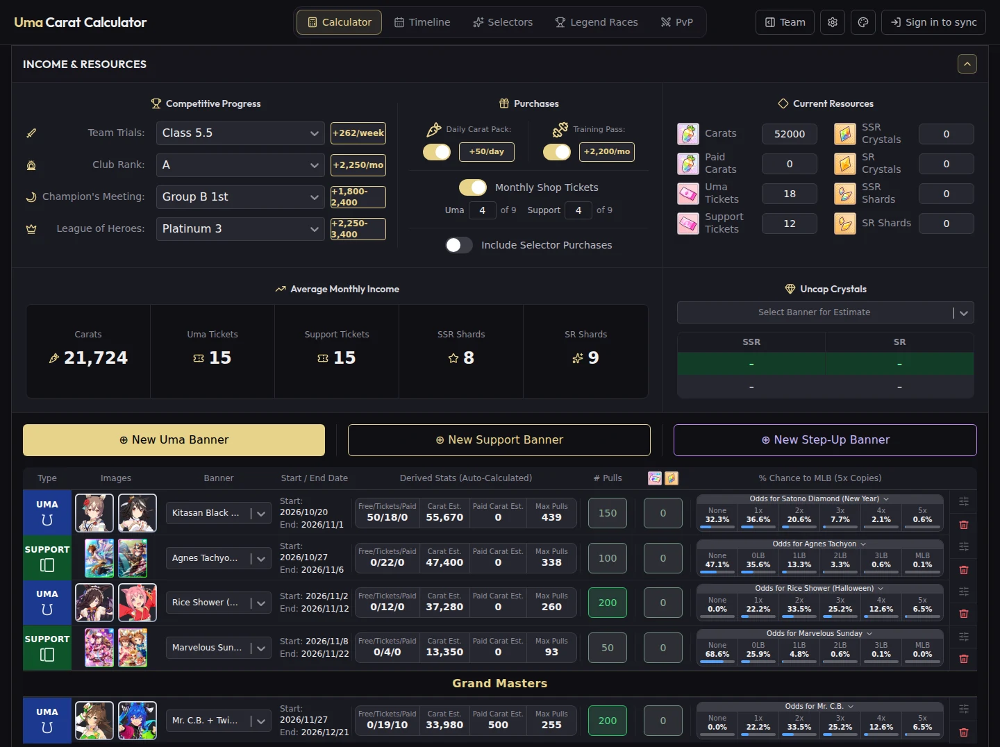
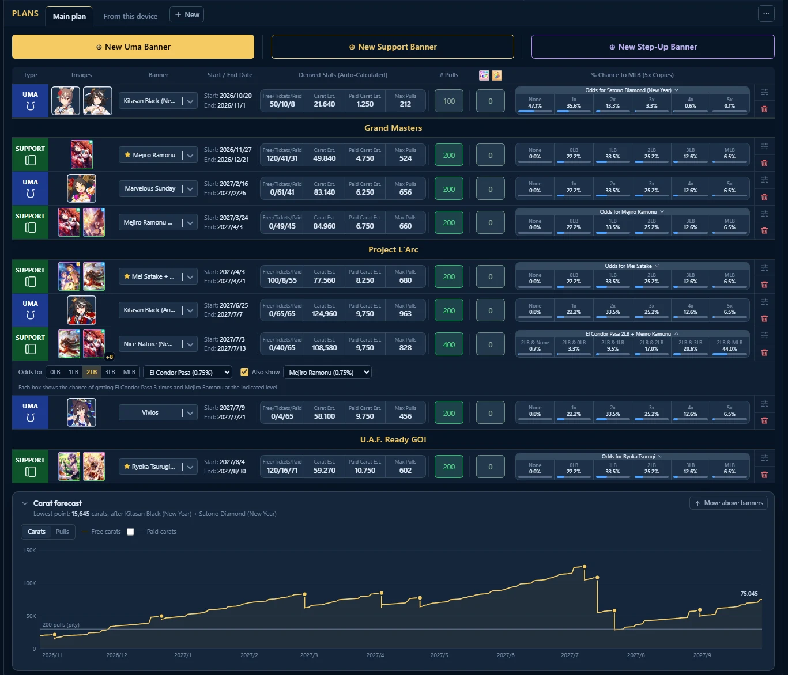
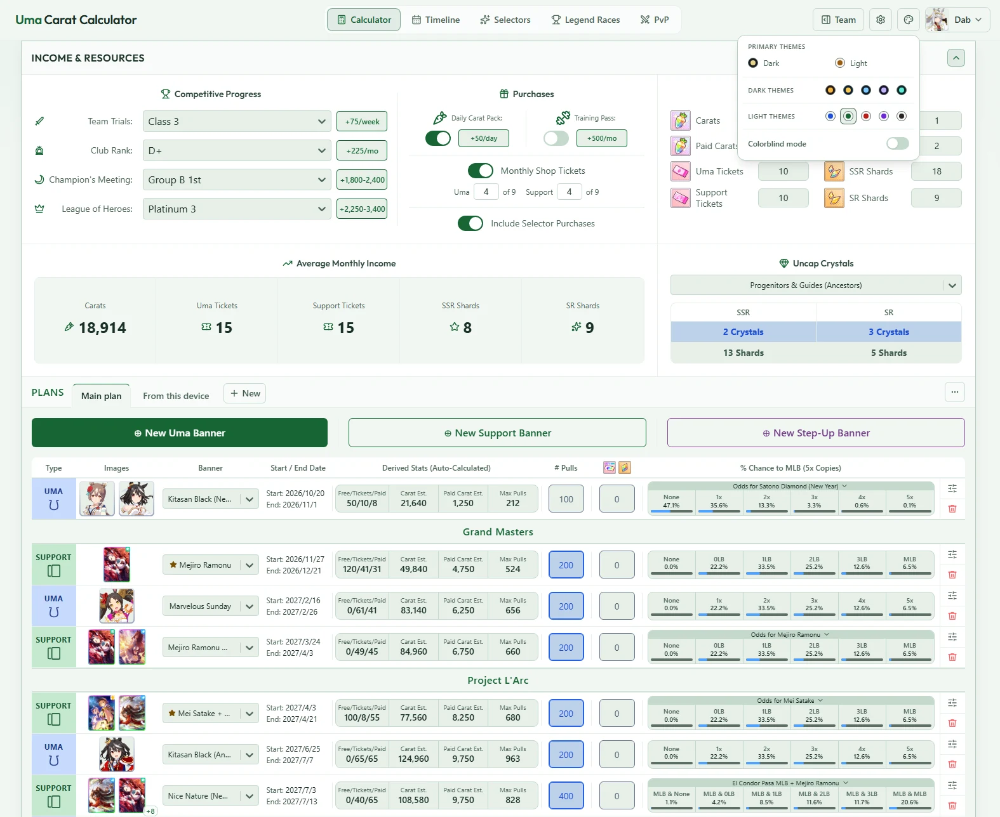
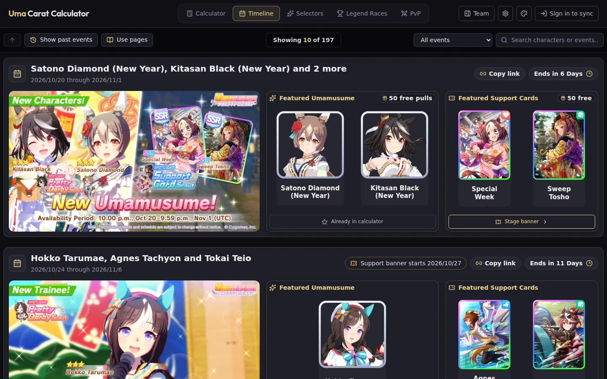
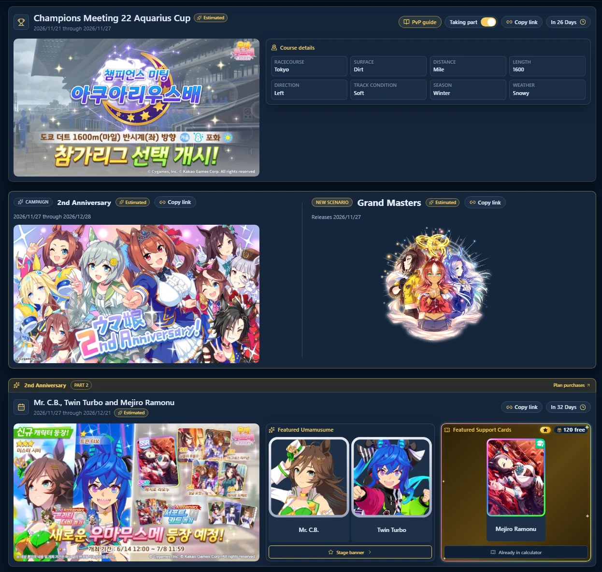
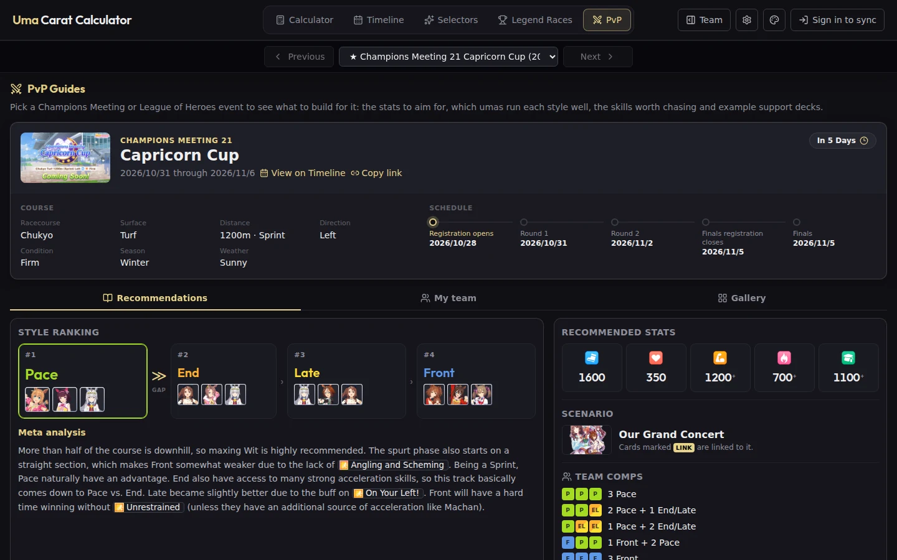
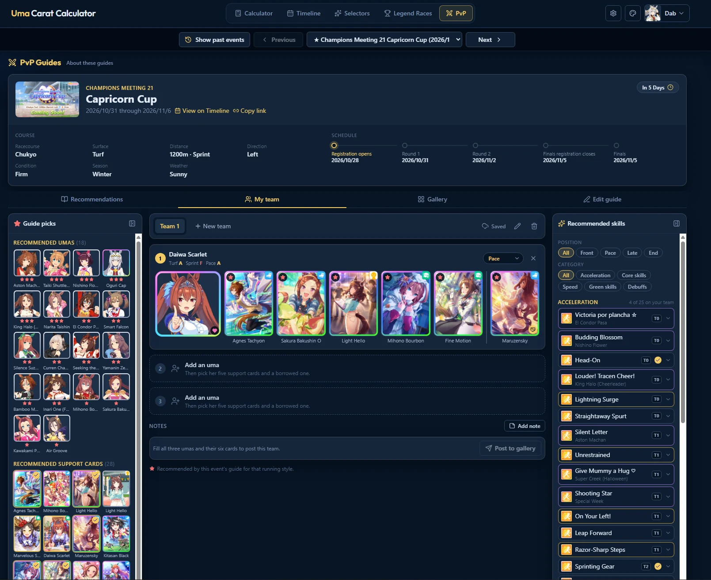
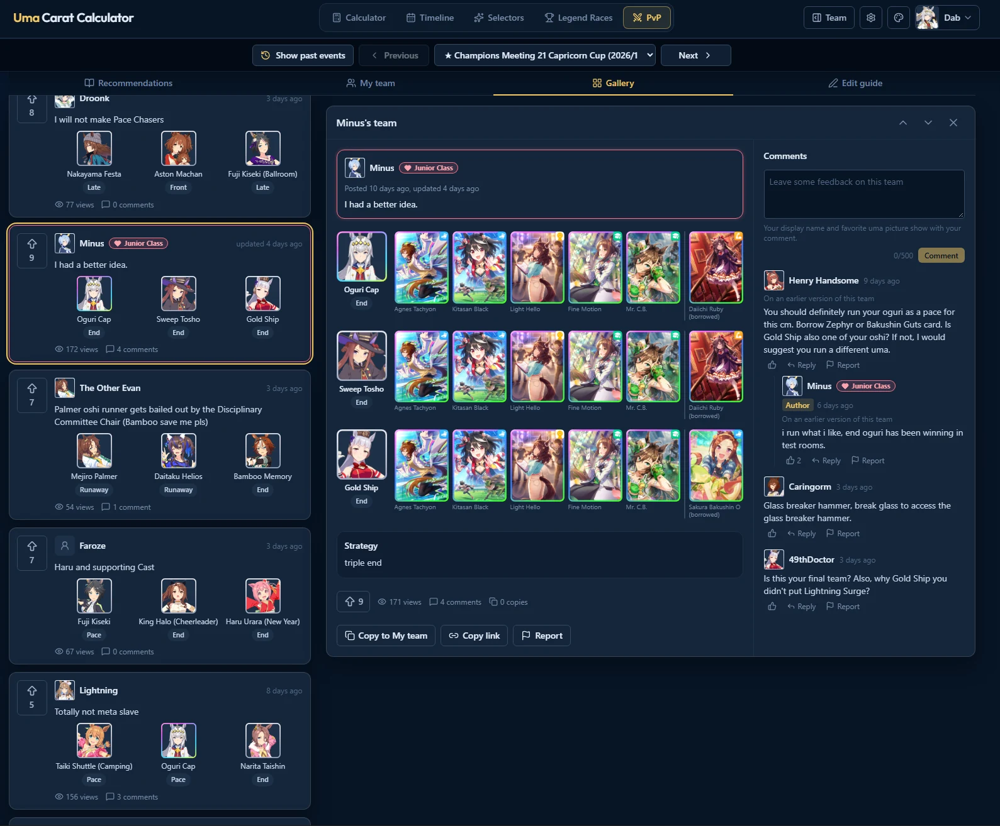

# Uma Carat Calculator (Web)

**Live at [umacaratcalculator.com](https://umacaratcalculator.com)**, a planning tool for
Uma Musume Pretty Derby players with over **100,000 visitors a month**. Since its September
2026 launch: nearly 400,000 visits, 16,600 accounts (95% of them actively planning) holding
18,500 saved plans, and 86 Patreon supporters.

[](https://github.com/charlesmerriman/uma-carat-calculator-web/actions/workflows/ci.yml)



This is the React frontend. The Django API behind it is
[uma-carat-calculator-api](https://github.com/charlesmerriman/uma-carat-calculator-api).

## What it does

Uma Musume is a gacha game: players save a premium currency (carats) and tickets, then spend
them on limited-time banners. This site tells a player what they will be holding on the day
each banner ends, before they spend rather than after.

- **The planner.** Enter what you hold and which income applies to your account (ranks, passes,
  events). Pick the banners you want and how many pulls each, and every row shows the carats and
  tickets left at that banner's end, with the odds of getting the card.
- **A forecast chart** of carats and pulls over time, with optional layers.
- **Twelve themes**, dark and light, and a colorblind mode.
- **Several plans per account**, each shareable by link. A shared link unfurls in Discord and on X
  with a server-drawn preview of the plan's totals.
- **Step-up banners, selector tickets and campaign packs**, each with its own rules.
- **A timeline** of upcoming banners, events and campaigns, with dates predicted from the
  Japanese server's schedule.
- **PvP guides** for Champions Meeting and League of Heroes: a guide per event that staff
  write in an on-site editor, a team planner, and a community gallery with votes, comments and
  moderation.

<table>
<tr>
<td width="50%" align="center" valign="top">
<b>The plan, its odds and the carat forecast</b><br><br>

</td>
<td width="50%" align="center" valign="top">
<b>Light themes, and a colorblind mode</b><br><br>

</td>
</tr>
<tr>
<td width="50%" align="center" valign="top">
<b>The timeline</b><br><br>

</td>
<td width="50%" align="center" valign="top">
<b>Campaigns, scenarios and race events</b><br><br>

</td>
</tr>
<tr>
<td width="50%" align="center" valign="top">
<b>A PvP guide</b><br><br>

</td>
<td width="50%" align="center" valign="top">
<b>The team planner</b><br><br>

</td>
</tr>
<tr>
<td colspan="2" align="center" valign="top">
<b>The PvP gallery</b><br><br>

</td>
</tr>
</table>

No page needs an account. A guest's plan is kept on their device, and signing in with Google,
Discord or Patreon moves it to the account.

## Engineering highlights

- **Prerendered, then hydrated.** Every public route is rendered to its own HTML document at build
  time ([`scripts/prerender.mjs`](scripts/prerender.mjs), [`src/entry-server.ts`](src/entry-server.ts)),
  so search engines and link previews see real content from a static host. Render-time code is
  kept free of `window` and `localStorage` so hydration matches.
- **One projection engine.** The API sends every reward as one dated income ledger; the browser
  computes the forecast. Income is a pure function of a banner's end date, all date maths runs in
  UTC ([`utils/utcDates.ts`](src/utils/utcDates.ts)), and the per-banner rows and the summary
  tiles read the same hook ([`useBannerResources`](src/hooks/useBannerResources.ts)), so two numbers
  on screen can't disagree. Its results are audited source by source against the community
  spreadsheet the site grew out of.
- **Guest-first state.** One provider ([`CalculatorProvider`](src/services/CalculatorProvider.tsx))
  loads everything in a single request. A tab decides once, at load, whether it saves to the
  device ([`guestPlanStore`](src/services/guestPlanStore.ts)) or the server, so a sign-in in
  another tab can never send device data to an account or the other way round.
- **Heavy features load on demand.** The chart library, the guide editor (with drag and drop)
  and the gallery are separate chunks a visitor only downloads when they open them.
- **Tested and checked on every push.** About 1,600 Vitest tests across hooks, maths and
  components; `npm run check` runs the type check, ESLint, [knip](https://knip.dev) (dead
  code) and the tests, and CI runs the same on every push to `develop` and `master`.

## Architecture

One site, two repositories, both deployed by DigitalOcean App Platform on every push to
`master`:

- **Web** (this repo): React 19 + TypeScript, built by Vite and served as a static site.
- **API** ([uma-carat-calculator-api](https://github.com/charlesmerriman/uma-carat-calculator-api)): Django 6 and Django REST Framework, on the same domain under `/api`.
- **Data**: managed PostgreSQL, with images on DigitalOcean Spaces behind its CDN.
- **Accounts**: Google, Discord or Patreon OAuth, exchanged for a token. Accounts keep nothing from the provider's profile: no email, name or picture.
- **Content**: banners, events and rewards are entered by hand in the Django admin, which doubles as the CMS.

## Tech stack

| Tool | Used for |
|---|---|
| React 19 + TypeScript | UI and type safety |
| Vite 7 | Dev server, production bundle and the server build used for prerendering |
| Tailwind CSS 4 | Styling |
| TanStack Query | Server state for the PvP gallery (paging, votes, comments) |
| Recharts | The forecast chart |
| dnd-kit | Drag and drop in the guide editor and team planner |
| Framer Motion | Animation |
| react-router-dom 7 | Routing |
| react-markdown | Guide and admin-written page content |
| Vitest + React Testing Library | Tests (jsdom) |
| ESLint, knip | Linting and dead-code checks |

## Quick start

Requires Node 24 (pinned under `engines` in `package.json`).

```bash
npm install
npm run dev        # http://localhost:5173 against a local API on :8000
npm run check      # type check + lint + knip + tests
```

The API's own setup is in [its README](https://github.com/charlesmerriman/uma-carat-calculator-api#quick-start).
Running against the live API, why the port is pinned, every command, the route list and how
site content reaches the build are in [docs/development.md](docs/development.md).

## Documentation

- [development.md](docs/development.md): local setup, commands, routes and the build
- [resource-projection-logic.md](docs/resource-projection-logic.md): how the forecast is computed, from the income ledger to step-ups, selector tickets and campaign purchases
- [state-and-guest-mode.md](docs/state-and-guest-mode.md): the provider, auto-save, guest mode, plans and the core types
- [ui-conventions.md](docs/ui-conventions.md): dates, styling and themes, the Timeline and the planner layout

The data model, endpoints, auth design and income schedule are documented in the
[API repo](https://github.com/charlesmerriman/uma-carat-calculator-api/tree/HEAD/docs).

## About this project

In continuous development since December 2025 and live since September 2026. The resource
model follows [Henry's resource spreadsheet](https://docs.google.com/spreadsheets/d/100t3hnYl5Qm2UR8RtPlH-8Xd9KQbBlxEdXUOIR4d394/),
the community reference built by Daptrius that this site grew out of. The application is my
own work: the projection engine, authentication, admin and deployment.

Visitor figures come from the site's own privacy-first analytics (no third-party trackers):
bots are filtered out and each browser session counts once, as of October 2026.

## License

[MIT](LICENSE)
